<p align="center">
  <picture>
    <source media="(prefers-color-scheme: dark)" srcset="assets/es/hero-dark.svg">
    
  </picture>
</p>

<p align="center"><a href="README.md">English</a> · <b>Español</b></p>

<h1 align="center">Kothar: un nombre y un logotipo para tu proyecto</h1>

<p align="center"><b>Nombres con su significado y logotipos probados antes de que los veas, elegidos paso a paso en tu navegador.</b></p>

<p align="center">
  
  
  
</p>

---

**Kothar es una skill para tu agente de IA que le pone nombre a tu proyecto y le dibuja su logotipo.** Lee qué hace tu proyecto, te propone nombres explicando de dónde viene cada uno y dibuja varias opciones de logotipo, cada una con su idea. Las prueba antes de enseñártelas, y tú eliges en una página que se abre en tu navegador. El logotipo de arriba es el que hizo para este repositorio.

```bash
/plugin marketplace add ilien-dev/kothar
/plugin install kothar@kothar
```

Eso en Claude Code. En Codex, Gemini y otros agentes:

```bash
npx skills add ilien-dev/kothar
```

## Cada opción tiene una idea detrás

<p align="center"><picture>
  <source media="(prefers-color-scheme: dark)" srcset="assets/es/readme/ideas-dark.svg">
  
</picture></p>

Un logotipo se recuerda mejor cuando cuenta algo. Por eso las opciones se reparten entre tres tipos de idea: unas salen del nombre, otras de lo que hace tu proyecto y otras unen las dos. Cada una trae su explicación: qué dibuja y por qué tiene que ver con tu proyecto. Todas pasan las mismas pruebas antes de llegar a ti:

- **Se leen en pequeño.** Cada una se mira a 16 píxeles, el tamaño de un icono de pestaña.
- **Son propias.** Se comparan con unos 21 000 logotipos e iconos conocidos; si una se parece a alguno, lo ves anotado junto a la opción.
- **Se entienden.** Revisores de IA que nunca han visto tu proyecto dicen qué ven, y lo que no reconocen se redibuja.

La lista completa de lo que se mide está en [docs/how-it-measures.md](docs/how-it-measures.md) (en inglés).

## Cómo funciona

<p align="center"><picture>
  <source media="(prefers-color-scheme: dark)" srcset="assets/es/readme/how-dark.svg">
  
</picture></p>

1. Pide a tu agente un nombre o un logotipo, con tus palabras. Te hace un par de preguntas y abre la página, que funciona en tu propio equipo.
2. Eliges el nombre y luego el logotipo. Después de cada paso, la página espera mientras tu agente prepara el siguiente.
3. Revisas la guía de identidad (el logotipo en todas sus versiones, sus tamaños y cómo usarlo) y guardas los archivos en `assets/logo/` de tu proyecto. Los cambios se piden en el chat.

**¿Ya tienes nombre?** Díselo a tu agente («mi proyecto se llama tu-app») y no te propondrá otros: empieza por el logotipo. Si solo quieres el símbolo, sin letras, pídelo así.

> [!NOTE]
> El logotipo se entrega en negro, blanco y gris. El color cambia más a menudo que un logotipo, así que lo eliges después, al diseñar tu web o tu README. La guía que acompaña a los archivos explica cómo aplicarlo.

## Instalación

<p align="center"><picture>
  <source media="(prefers-color-scheme: dark)" srcset="assets/es/readme/install-dark.svg">
  
</picture></p>

**Claude Code**, como plugin:

```bash
/plugin marketplace add ilien-dev/kothar
/plugin install kothar@kothar
```

**Codex, Gemini y otros agentes**, desde la carpeta de tu proyecto:

```bash
npx skills add ilien-dev/kothar
```

El instalador detecta los agentes que tienes y te deja elegir en cuáles instalarla. Añade `-g` para tenerla en todos tus proyectos.

> [!IMPORTANT]
> Kothar necesita Node 20 o superior en cualquier agente, y el instalador `npx skills` pide además Node 22.20 o superior. La primera vez descarga el renderizador de SVG y el conjunto de logotipos conocidos con los que compara; tarda un par de minutos, una sola vez.

## Desarrollo

El código está en TypeScript en `src/` y se compila dentro de la skill con `npm run build`; `npm test` compila y ejecuta las pruebas. Cómo compilarlo, probarlo y dónde guarda sus archivos de trabajo está en [docs/development.md](docs/development.md) (en inglés).

## Contribuir

Lee [CONTRIBUTING.md](CONTRIBUTING.md) antes de abrir un issue o un pull request. Las vulnerabilidades se informan en privado, como explica [SECURITY.md](SECURITY.md).

## Licencia

MIT. Los logotipos e iconos conocidos con los que compara se descargan al instalar, con sus propias licencias, y no se redistribuyen; los logotipos de marcas pertenecen a sus dueños y solo se usan para medir parecidos.
