<p align="center">
  <picture>
    <source media="(prefers-color-scheme: dark)" srcset="assets/es/hero-dark.svg">
    
  </picture>
</p>

<p align="center"><a href="README.md">English</a> · <b>Español</b></p>

<h1 align="center">Kothar: un logo y una marca para tu proyecto</h1>

<p align="center"><b>Logos que parten de tus referencias, probados al tamaño de una pestaña, y un brand book que puedes enviar a quien quieras.</b></p>

<p align="center">
  
  
  
</p>

---

**Kothar es una skill para tu agente de IA que dibuja el logo de tu proyecto y construye su marca.** Es para quien saca un proyecto sin diseñador. Te pregunta qué te gusta y dibuja varias propuestas de logo, cada una con su propia idea. Cuando eliges una, construye lo demás: colores, tipografías, las piezas que necesitas y un brand book que muestra tu logo en todos los lugares donde va a aparecer.

## Cómo funciona

<p align="center"><picture>
  <source media="(prefers-color-scheme: dark)" srcset="assets/es/readme/how-dark.svg">
  
</picture></p>

Todo ocurre en el chat, con preguntas y opciones para elegir. La imagen muestra el paso que nunca ves: antes de que te llegue un logo, tu agente escribe muchas ideas, se queda con las pocas que son distintas y redibuja cada una hasta que funciona en grande y en una pestaña del navegador.

1. **Para qué es.** Tu agente lee tu repositorio, o te pregunta qué es el producto.
2. **Tus referencias.** Imágenes de logos, webs o cualquier cosa con el aspecto que buscas, o una descripción de marcas que admiras. Son lo que más guía el diseño.
3. **Las propuestas.** Se abre un informe en tu navegador con cada logo, su idea, sus colores y algunas maquetas. Eliges en el chat.
4. **El brand book.** Tu agente lo construye todo en `assets/brand/` y abre el brand book. Pides cambios en el chat.

Antes de cada informe te pregunta si lo quieres en tu idioma o en inglés.

## Qué obtienes

<p align="center"><picture>
  <source media="(prefers-color-scheme: dark)" srcset="assets/es/readme/features-dark.svg">
  
</picture></p>

- **Siempre:** el símbolo y una versión para tamaños pequeños, el logo con el nombre en horizontal y en vertical, versiones en color y a una tinta, la paleta con su contraste, tipografías gratuitas, favicon, iconos de app y una imagen para compartir enlaces.
- **Imágenes para redes**, las que elijas: GitHub, X, LinkedIn, Instagram, TikTok, YouTube, Discord, Bluesky y más, cada una a su tamaño.
- **Papelería**, si la quieres: membrete, la maqueta de un contrato, tarjeta de visita, firma de correo, factura y una diapositiva.
- **Un logo animado**, si quieres uno.
- **El brand book:** un único archivo HTML con la idea, el logo en todos los tamaños, colores y tipografías, cómo usarlo y cómo no, y maquetas. Se imprime en PDF.

## Instalación

<p align="center"><picture>
  <source media="(prefers-color-scheme: dark)" srcset="assets/es/readme/install-dark.svg">
  
</picture></p>

**Claude Code**, como plugin:

```bash
/plugin marketplace add ilien-dev/kothar
/plugin install kothar@kothar
```

Después pídele a tu agente un logo, o escribe `/kothar:kothar`.

<details><summary><b>Codex, Gemini y otros agentes</b></summary>

Desde la carpeta de tu proyecto:

```bash
npx skills add ilien-dev/kothar
```

El instalador encuentra los agentes que tienes y te deja elegir dónde instalarla. Añade `-g` para tenerla en todos tus proyectos. Necesita Node 22.20 o posterior.

</details>

> [!TIP]
> Para exportar archivos PNG y pasar el nombre a contornos, tu agente usa Chrome, Edge, Brave o Chromium si tienes alguno, sin abrir ninguna ventana. Sin ellos, igualmente recibes los archivos SVG y el brand book.

## Desarrollo

La skill es Markdown más dos archivos HTML, sin paso de compilación. Cómo está organizada y cómo probar un cambio está en [docs/development.md](docs/development.md).

## Contribuir

Lee [CONTRIBUTING.md](CONTRIBUTING.md) antes de abrir un issue o un pull request. Informa de vulnerabilidades en privado como se describe en [SECURITY.md](SECURITY.md).

## Licencia

MIT. El texto completo está en [LICENSE](LICENSE).
