<p align="center">
  <picture>
    <source media="(prefers-color-scheme: dark)" srcset="assets/es/hero-dark.svg">
    
  </picture>
</p>

<p align="center"><a href="README.md">English</a> · <b>Español</b></p>

<h1 align="center">Kothar: un nombre y una marca para tu proyecto</h1>

<p align="center"><b>Nombres con su significado, logotipos que parten de tus referencias y un manual de marca que puedes enviar a quien quieras.</b></p>

<p align="center">
  
  
  
</p>

---

**Kothar es una skill para tu agente de IA que le pone nombre a tu proyecto y construye su marca.** Te pregunta qué te gusta, propone nombres con su origen y dibuja varias propuestas de logotipo, cada una con su propia idea. Cuando eliges una, construye lo demás: colores, tipografías, las piezas que necesitas y un manual de marca que muestra tu logotipo en todos los tamaños y en todos los lugares donde va a aparecer.

```bash
/plugin marketplace add ilien-dev/kothar
/plugin install kothar@kothar
```

Eso es para Claude Code. En Codex, Gemini y otros agentes:

```bash
npx skills add ilien-dev/kothar
```

## Cómo funciona

Todo pasa en la conversación, con preguntas y opciones para elegir.

1. **Para qué es.** Tu agente lee tu repositorio o, si no lo hay, te pregunta qué es el producto.
2. **Tus referencias.** Te pide imágenes de logotipos, sitios web y cualquier cosa que se parezca a cómo quieres que luzca tu marca. Si no tienes, descríbelas: marcas que admiras y por qué. Es lo que más orienta el diseño.
3. **El nombre.** Conserva el tuyo o elige entre diez o más candidatos, cada uno con lo que representa y por qué encaja.
4. **Cuántos logotipos, qué colores y qué piezas.** Eliges de la lista de abajo.
5. **Las propuestas.** Tu agente escribe muchas ideas, se queda con las más fuertes y distintas entre sí, las dibuja, las mira a 16 píxeles y a tamaño completo, y las afina. Se abre en tu navegador un informe con cada propuesta, su idea, su paleta y algunas maquetas. Eliges en el chat.
6. **El manual de marca.** Tu agente construye la identidad y cada pieza que elegiste en `assets/brand/`, y abre el manual. Los cambios se piden en el chat.

Antes de cada informe te pregunta si lo quieres en tu idioma o en inglés.

## Qué puedes obtener

- **Siempre:** el símbolo y una versión para tamaños pequeños, el logotipo horizontal y apilado, versiones a color, a una tinta y en negativo, la paleta con sus contrastes, las tipografías (libres, de Google Fonts), favicon e iconos de app, una imagen para vistas previas de enlaces y `tokens.json`.
- **Redes sociales**, las que elijas: GitHub, X, LinkedIn, Facebook, Instagram, TikTok, YouTube, Discord, Bluesky, Mastodon, Threads, Reddit y Product Hunt, con la medida de cada una.
- **Papelería**, las piezas que elijas: papel membretado, plantilla de contrato (la maquetación, no el texto legal), tarjeta de presentación, firma de correo, factura y una diapositiva.
- **Un logotipo animado**, si lo quieres.
- **El manual de marca:** un solo archivo HTML con la idea, la construcción, el logotipo en todos sus tamaños, los colores y las tipografías, cómo usarlo y cómo no, y maquetas en una terminal, un README, el esqueleto de una web, perfiles sociales y pegatinas. Se imprime a PDF.

## Instalación

<p align="center"><picture>
  <source media="(prefers-color-scheme: dark)" srcset="assets/es/readme/install-dark.svg">
  
</picture></p>

**Claude Code**, como plugin:

```bash
/plugin marketplace add ilien-dev/kothar
/plugin install kothar@kothar
```

**Codex, Gemini y otros agentes**, desde la carpeta de tu proyecto:

```bash
npx skills add ilien-dev/kothar
```

El instalador encuentra los agentes que tienes y te deja elegir dónde instalarla. Añade `-g` para tenerla en todos tus proyectos.

> [!NOTE]
> No hay nada más que instalar. Para convertir los archivos a PNG y pasar el nombre a contornos, tu agente usa Chrome, Edge, Brave o Chromium si tienes alguno, sin abrir ninguna ventana. Sin ellos recibes los archivos SVG y el manual. El instalador `npx skills` necesita Node 22.20 o posterior.

## Desarrollo

La skill es Markdown más dos archivos HTML, sin paso de compilación. Cómo está organizada y cómo probar un cambio está en [docs/development.md](docs/development.md).

## Contribuir

Lee [CONTRIBUTING.md](CONTRIBUTING.md) antes de abrir un issue o un pull request. Informa de vulnerabilidades en privado como se explica en [SECURITY.md](SECURITY.md).

## Licencia

MIT.
