<p align="center">
  <picture>
    <source media="(prefers-color-scheme: dark)" srcset="assets/hero-dark.svg">
    
  </picture>
</p>

<p align="center"><b>English</b> · <a href="README.es.md">Español</a></p>

<h1 align="center">Kothar: a name and a logo for your project</h1>

<p align="center"><b>Names with their meaning and logos tested before you see them, chosen step by step in your browser.</b></p>

<p align="center">
  
  
  
</p>

---

**Kothar is a skill for your AI agent that names your project and draws its logo.** It reads what your project does, proposes names with where each one comes from, and draws several logo options, each with its own idea. It tests them before you see them, and you choose in a page that opens in your browser. The logo at the top of this page is what it made for this repository.

```bash
/plugin marketplace add ilien-dev/kothar
/plugin install kothar@kothar
```

That is for Claude Code. In Codex, Gemini and other agents:

```bash
npx skills add ilien-dev/kothar
```

## Every option has an idea behind it

<p align="center"><picture>
  <source media="(prefers-color-scheme: dark)" srcset="assets/readme/ideas-dark.svg">
  
</picture></p>

A logo is easier to remember when it tells something. So the options are split between three kinds of idea: some come from the name, some from what your project does, and some join the two. Each one comes with its explanation: what it shows and why it belongs to your project. Every option passes the same tests before it reaches you:

- **Clear when small.** Each one is checked at 16 pixels, the size of a browser tab icon.
- **Its own shape.** It is compared with about 21,000 known logos and icons; if it looks like one, you see it noted next to the option.
- **Understood by strangers.** AI reviewers that have never seen your project say what they see, and what they do not recognise is redrawn.

The full list of what is measured is in [docs/how-it-measures.md](docs/how-it-measures.md).

## How it works

<p align="center"><picture>
  <source media="(prefers-color-scheme: dark)" srcset="assets/readme/how-dark.svg">
  
</picture></p>

1. Ask your agent for a name or a logo, in your own words. It asks a couple of questions and opens the page, which runs on your own computer.
2. Choose the name, then the logo. After each step the page waits while your agent prepares the next one.
3. Review the identity guide (the logo in every version, its sizes and how to use it) and save the files into your project's `assets/logo/`. Ask for changes in the chat.

**Already have a name?** Tell your agent ("my project is called tu-app") and it will not propose others: it starts with the logo. If you only want the symbol, without letters, ask for that.

> [!NOTE]
> The logo comes in black, white and grey. Colour changes more often than a logo, so you choose it later, when you design your site or your README. The guide that comes with the files explains how to apply it.

## Install

<p align="center"><picture>
  <source media="(prefers-color-scheme: dark)" srcset="assets/readme/install-dark.svg">
  
</picture></p>

**Claude Code**, as a plugin:

```bash
/plugin marketplace add ilien-dev/kothar
/plugin install kothar@kothar
```

**Codex, Gemini and other agents**, from your project's folder:

```bash
npx skills add ilien-dev/kothar
```

The installer finds the agents you have and lets you choose where to install it. Add `-g` to have it in every project.

> [!IMPORTANT]
> Kothar needs Node 20 or later in every agent, and the `npx skills` installer itself needs Node 22.20 or later. The first run downloads the SVG renderer and the set of known logos it compares against, which takes a couple of minutes, once.

## Development

Source is TypeScript in `src/`, compiled into the skill with `npm run build`; `npm test` builds and runs the tests. How to build and test it, and where it keeps its working files, is in [docs/development.md](docs/development.md).

## Contributing

Read [CONTRIBUTING.md](CONTRIBUTING.md) before opening an issue or a pull request. Report vulnerabilities privately as described in [SECURITY.md](SECURITY.md).

## Licence

MIT. The known logos and icons it compares against are downloaded at setup under their own licences and are not redistributed; brand logos are trademarks of their owners and are used only to measure likeness.
