<p align="center">
  <picture>
    <source media="(prefers-color-scheme: dark)" srcset="assets/hero-dark.svg">
    
  </picture>
</p>

<p align="center"><b>English</b> · <a href="README.es.md">Español</a></p>

<h1 align="center">Kothar: a name and a brand for your project</h1>

<p align="center"><b>Names with their meaning, logos drawn from your references, and a brand book you can send to anyone.</b></p>

<p align="center">
  
  
  
</p>

---

**Kothar is a skill for your AI agent that names your project and builds its brand.** It asks what you like, proposes names with where each one comes from, and draws several logo proposals, each with its own idea. When you choose one, it builds the rest: colours, fonts, the pieces you need, and a brand book that shows your logo at every size and in every place it will live.

```bash
/plugin marketplace add ilien-dev/kothar
/plugin install kothar@kothar
```

That is for Claude Code. In Codex, Gemini and other agents:

```bash
npx skills add ilien-dev/kothar
```

## How it works

Everything happens in the conversation, through questions with options to pick from.

1. **What it is for.** Your agent reads your repository, or asks what the product is if there is none.
2. **Your references.** It asks for images of logos, websites and anything else that looks the way you want your brand to look. If you have none, describe them: brands you admire and why. This is what steers the design the most.
3. **The name.** Keep yours, or choose among ten or more candidates, each with what it refers to and why it fits.
4. **How many logos, which colours, which pieces.** Pick from the list below.
5. **The proposals.** Your agent writes many ideas, keeps the strongest and most different, draws them, looks at them at 16 pixels and at full size, and refines them. A report opens in your browser with each proposal, its idea, its palette and a few mockups. You choose in the chat.
6. **The brand book.** Your agent builds the identity and every piece you selected into `assets/brand/`, and opens the brand book. You ask for changes in the chat.

Before each report it asks whether you want it in your language or in English.

## What you can get

- **Always:** the symbol and a version for small sizes, horizontal and stacked lockups, colour, one-colour and reversed versions, the palette with its contrast ratios, the fonts (free, from Google Fonts), favicon and app icons, a link-preview image, and `tokens.json`.
- **Social networks**, the ones you choose: GitHub, X, LinkedIn, Facebook, Instagram, TikTok, YouTube, Discord, Bluesky, Mastodon, Threads, Reddit and Product Hunt, at each network's size.
- **Stationery**, the pieces you choose: letterhead, a contract template (the layout, not legal text), business card, email signature, invoice and a presentation slide.
- **An animated logo**, if you want one.
- **The brand book:** a single HTML file that shows the idea, the construction, the logo at every size, the colours and fonts, how to use it and how not to, and mockups in a terminal, a README, a website skeleton, social profiles and stickers. It prints to PDF.

## Install

<p align="center"><picture>
  <source media="(prefers-color-scheme: dark)" srcset="assets/readme/install-dark.svg">
  
</picture></p>

**Claude Code**, as a plugin:

```bash
/plugin marketplace add ilien-dev/kothar
/plugin install kothar@kothar
```

**Codex, Gemini and other agents**, from your project's folder:

```bash
npx skills add ilien-dev/kothar
```

The installer finds the agents you have and lets you choose where to install it. Add `-g` to have it in every project.

> [!NOTE]
> Nothing else to install. To turn the files into PNG and to set the name in outlines, your agent uses Chrome, Edge, Brave or Chromium if you have one, without opening a window. Without one, you get the SVG files and the brand book. The `npx skills` installer needs Node 22.20 or later.

## Development

The skill is Markdown plus two HTML files, with no build step. How it is organised and how to test a change is in [docs/development.md](docs/development.md).

## Contributing

Read [CONTRIBUTING.md](CONTRIBUTING.md) before opening an issue or a pull request. Report vulnerabilities privately as described in [SECURITY.md](SECURITY.md).

## Licence

MIT.
