<p align="center">
  <picture>
    <source media="(prefers-color-scheme: dark)" srcset="assets/hero-dark.svg">
    
  </picture>
</p>

<p align="center"><b>English</b> · <a href="README.es.md">Español</a></p>

<h1 align="center">Kothar: a logo and a brand for your project</h1>

<p align="center"><b>Logos drawn from your references, checked at the size of a tab, and a brand book you can send anyone.</b></p>

<p align="center">
  
  
  
</p>

---

**Kothar is a skill for your AI agent that draws your project's logo and builds its brand.** It is for anyone shipping a project without a designer. It asks what you like and draws several logo proposals, each with its own idea. When you pick one, it builds the rest: colours, fonts, the pieces you need, and a brand book that shows your logo everywhere it will live.

## How it works

<p align="center"><picture>
  <source media="(prefers-color-scheme: dark)" srcset="assets/readme/how-dark.svg">
  
</picture></p>

Everything happens in the chat, through questions with options to pick from. The picture shows the step you never see: before a logo reaches you, your agent writes many ideas, keeps the few that differ, and redraws each one until it holds up both large and in a browser tab.

1. **What it is for.** Your agent reads your repository, or asks what the product is.
2. **Your references.** Images of logos, websites or anything with the look you want, or a description of brands you admire. They steer the design the most.
3. **The proposals.** A report opens in your browser with each logo, its idea, its colours and a few mockups. You choose in the chat.
4. **The brand book.** Your agent builds everything into `assets/brand/` and opens the brand book. Ask for changes in the chat.

Before each report it asks whether you want it in your language or in English.

## What you get

<p align="center"><picture>
  <source media="(prefers-color-scheme: dark)" srcset="assets/readme/features-dark.svg">
  
</picture></p>

- **Always:** the symbol and a cut for small sizes, the logo with the name side by side and stacked, colour and one-colour versions, the palette with its contrast, free fonts, favicon, app icons and a link-preview image.
- **Social images**, for the networks you choose: GitHub, X, LinkedIn, Instagram, TikTok, YouTube, Discord, Bluesky and more, each at its own size.
- **Stationery**, if you want it: letterhead, a contract layout, business card, email signature, invoice and a slide.
- **An animated logo**, if you want one.
- **The brand book:** one HTML file with the idea, the logo at every size, colours and fonts, how to use it and how not to, and mockups. It prints to PDF.

## Install

<p align="center"><picture>
  <source media="(prefers-color-scheme: dark)" srcset="assets/readme/install-dark.svg">
  
</picture></p>

**Claude Code**, as a plugin:

```bash
/plugin marketplace add ilien-dev/kothar
/plugin install kothar@kothar
```

Then ask your agent for a logo, or type `/kothar:kothar`.

<details><summary><b>Codex, Gemini and other agents</b></summary>

From your project's folder:

```bash
npx skills add ilien-dev/kothar
```

The installer finds the agents you have and lets you choose where to install it. Add `-g` to have it in every project. It needs Node 22.20 or later.

</details>

> [!TIP]
> To export PNG files and set the name in outlines, your agent uses Chrome, Edge, Brave or Chromium if you have one, without opening a window. Without one, you still get the SVG files and the brand book.

## Development

The skill is Markdown plus two HTML files, with no build step. How it is organised and how to test a change is in [docs/development.md](docs/development.md).

## Contributing

Read [CONTRIBUTING.md](CONTRIBUTING.md) before opening an issue or a pull request. Report vulnerabilities privately as described in [SECURITY.md](SECURITY.md).

## Licence

MIT. The full text is in [LICENSE](LICENSE).
