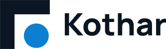

# Kothar · logotipo

Todo lo necesario para usar el logotipo, generado con kothar el 2026-11-19.

## La idea

**Kothar**: Kothar-wa-Khasis, el dios artesano de Ugarit: forjó las dos mazas de Baal y, antes de entregarlas, le puso nombre a cada una. El plugin hace los dos oficios del dios: le pone nombre a un producto y forja su logotipo, y no entrega la pieza hasta haberla medido.

**Escuadra y punto.** Lo que hace el plugin: poner una forma contra la escuadra y medirla antes de darla por buena.

## Archivos

| Archivo | Úsalo para |
|---|---|
| `kothar-mark.svg` | el logotipo a color, sobre fondos claros |
| `kothar-mark-on-dark.svg` | el logotipo sobre fondos oscuros |
| `kothar-mark-mono.svg` | el logotipo en una sola tinta |
| `kothar-logo.svg` | logotipo + nombre, sobre fondos claros |
| `kothar-logo-on-dark.svg` | logotipo + nombre, sobre fondos oscuros |
| `kothar-logo-mono.svg` | logotipo + nombre en una tinta |
| `kothar-wordmark-mono.svg` | el nombre solo, en una tinta |
| `kothar-mark-animated.svg` | el logotipo animado |
| `favicon.ico` | icono de pestaña del navegador |
| `favicon.svg` | icono de pestaña del navegador |
| `apple-touch-icon.png` | icono de pantalla de inicio, 180 px |
| `png/kothar-mark-16…512.png` | copias en píxeles del logotipo |
| `png/kothar-logo-800.png`, `-1600.png`, `-on-dark-1600.png` | copias en píxeles de logotipo + nombre |
| `og-image.png` | imagen de vista previa de enlaces, 1200 × 630 |

Los colores también están como variables CSS en `colors.css` y como datos en `tokens.json`.

## Qué versión usar

- Sobre fondos claros: los archivos a color.
- Sobre fondos oscuros o fotos: los archivos «on-dark».
- Cuando solo hay una tinta (grabado, sello, interfaz monocroma): los archivos de una tinta, que toman el color del texto que los rodea (`currentColor`).

## Colores · Plano técnico

| Papel | Hex |
|---|---|
| Primario | `#0B1622` |
| Acento | `#0B7FD0` |
| Fondo claro | `#F3F6FA` |
| Fondo oscuro | `#0A1420` |
| Neutro | `#7F8B99` |
| Primario, sobre fondos oscuros | `#F3F6FA` |
| Acento, sobre fondos oscuros | `#4DA8F0` |

Contraste del logotipo: 16.82:1 sobre el fondo claro, 17.09:1 sobre el fondo oscuro.

## Tipografía

**Manrope** 800 · licencia: OFL-1.1

## Tamaños

- Tamaño mínimo en que el logotipo se mantiene limpio: **16 px**.

## Zona de respeto

Deja libre al menos el 12 % del ancho del logotipo en cada lado. Nada más entra en esa zona.

## Logotipo animado

`kothar-mark-animated.svg`. Opcional. Úsalo una vez, al cargar o en una pantalla de inicio; respeta el ajuste de reducir movimiento y termina en el logotipo completo.

## No se debe

- recolorearlo fuera de esta paleta
- estirarlo, girarlo, contornearlo ni añadirle sombras o degradados
- ponerlo sobre un fondo donde baje de 3:1 de contraste
- redibujarlo ni reconstruirlo con una fuente

## Medido

- Logotipo o icono conocido más parecido: brand logo “Grid.ai” (0.682).
- Jueces ciegos que lo reconocieron: 3 / 3 (16 px: 3 / 3).
- Jueces ciegos que leyeron el nombre: 3 / 3.

El reporte completo de identidad está en `identity-report.html`.
